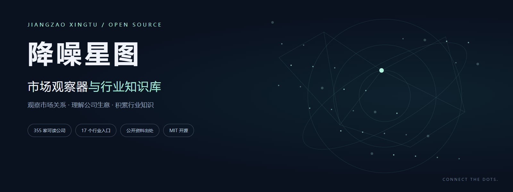
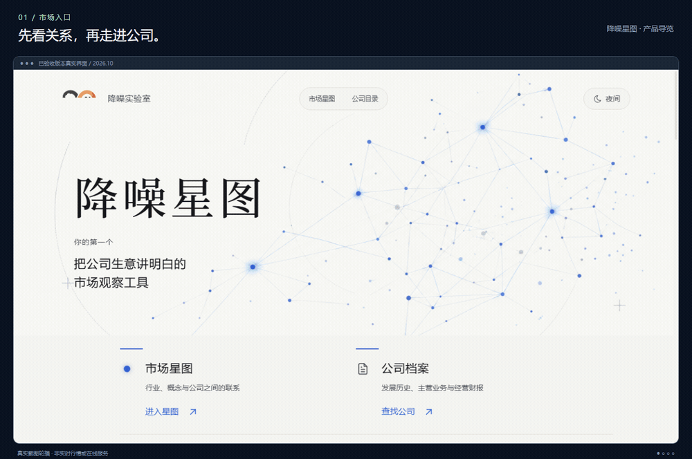
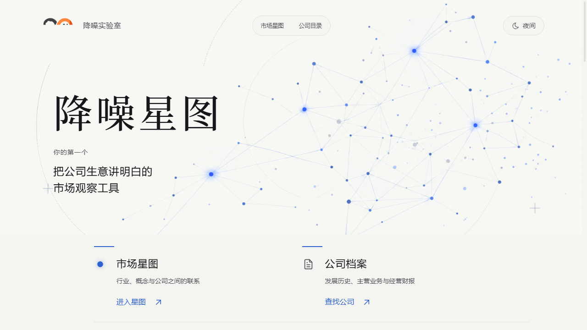
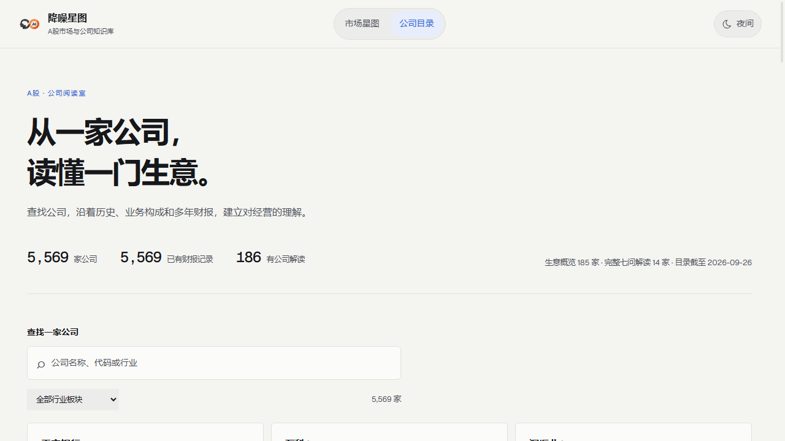
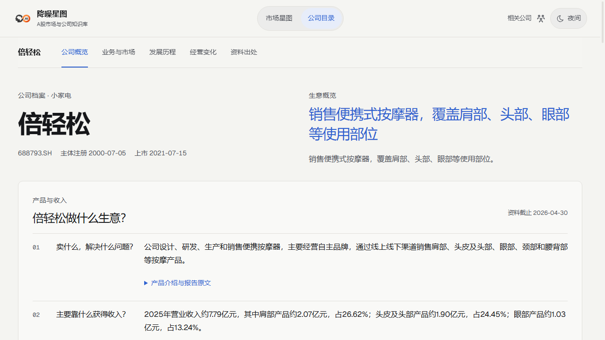
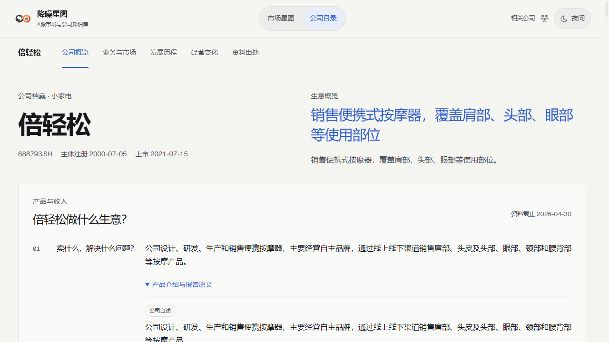

  

  <strong>市场观察器与行业知识库</strong> 
  观察市场关系，理解公司生意，让行业知识有处可查。

  
  
  

355 家可读公司 · 17 个行业分类 · 14 家七问 · 公开资料出处 · 无需安装

## 先选一个你想弄明白的问题

| 你可能好奇 | 从这里读起 |
| --- | --- |
| 一瓶牛奶，怎样从奶源变成公司的收入？ | [阳光乳业](docs/companies/001318.SZ.md) · [伊利股份](docs/companies/600887.SH.md) |
| 供应链公司收入很大，为什么不一定很赚钱？ | [建发股份](docs/companies/600153.SH.md) |
| 天然气公司卖气，也卖什么服务？ | [蓝天燃气](docs/companies/605368.SH.md) |
| 设备厂交付一台机器，还是一整条生产线？ | [亚联机械](docs/companies/001395.SZ.md) |
| 服务器制造商的钱，花在材料、研发还是备货？ | [工业富联](docs/companies/601138.SH.md) |

**[打开全部公司目录 →](docs/companies/README.md)**　**[按行业比较 →](docs/industries/README.md)**

每篇从“卖什么、谁付钱、收入怎么来”开始，保留报告日期、原文链接和口径说明。先读一家公司，再横着比较同一行业，最后回到披露材料核对。

## 星图想做什么

信息很多，理解常常是散的。我们希望把**市场关系、公司生意、行业知识**连起来：从一个产品或行业出发，知道谁在参与、怎样交付、收入来自哪里、有哪些变化值得继续观察。

当前内容以 A 股公司为起点。仓库已有 **186 家编辑内容**，本次找回并整理 **169 家历史研究笔记**，合计 **355 家**；七问和完整拆解是其中的深入阅读层次。新增笔记保留独立标记，不代表所有公司已经完成同样深度的研究。[查看整理记录](docs/research-notes.md)

## 看一遍星图的阅读方式

2026 年 10 月历史版本真实截图轮播，展示关系与阅读设计。原在线服务已停止；当前可直接在本仓库阅读上述公司笔记，图中行情与数值不是实时信息。

查看高清界面

## 把一个问题留下来

你正在看哪个行业？哪家公司的赚钱方式最难理解？带着具体问题，星图才知道下一处应该补哪里。

- **想收藏阅读：** Star 本仓库，下次从[公司目录](docs/companies/README.md)继续。
- **想补充线索或纠错：** [留下公司、问题和公开出处](https://github.com/ZHY999999999/jiangzao-xingtu-open-source/issues/new?template=research.yml)。
- **想参与整理：** [阅读贡献说明](CONTRIBUTING.md)，从修正一条有出处的内容开始。
- **想关注后续作品：** [关注作者的 GitHub](https://github.com/ZHY999999999)。

无需留下手机号、微信或其他私人信息。更新按实际整理进度进行，不承诺实时覆盖或固定频率。

源码、运行与许可

网站源码快照为 **1.2.26**，使用 React / TypeScript / Three.js。[查看源码](app/) · [开发说明](docs/development-guide.md)。阅读 Markdown 无需安装；运行旧版完整网站另需有权使用的运行数据，本仓库不公开提供该数据包，clone 后不能直接构建完整网站。

自主代码采用 [MIT License](LICENSE)。第三方依赖、字体、图片、引用原文及数据遵循各自许可和权利；MIT 不为第三方材料提供额外授权。原接口数据、采集缓存、私有项目历史及凭据不随本仓库发布。

---

<strong>从一门生意出发，慢慢看懂一个行业。</strong> 基于公开披露资料整理，供学习交流，不构成投资建议。资料可能存在遗漏、误读或过时，请以原始披露为准。

